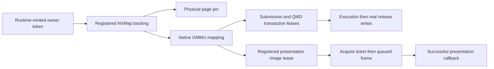

# Native GPU backend: first ownership and execution slice

Date: 2026-11-05. This is source work following commit `30e2337`.
The existing `v197-ns2-frontend` testing binary and installed game copies are
unchanged. Validation builds use temporary output locations.

## Scope and qualification

The first backend implementation covers native memory leases, worker queue
admission, QMD3 dependency/release scheduling, a restricted synchronous OpenGL
compute backend, and retained linear-RGBA presentation. These are internal
runtime APIs. **Guest GSV/worker/VI2 IPC commands are not wired to them yet.**
There is no new Bananza first-frame or gameplay result.

The ownership and scheduler tests execute the production C/C++ components with
controlled GPU/presentation callbacks. They establish lifetime and completion
contracts, not physical GPU execution. The actual OpenGL dispatch/presentation
implementations are compiled in the X11 build; they have not been exercised
with an authenticated guest submission in this slice.

## Ownership model



[native_gpu.h](../runtime/native_gpu.h) exposes the ownership boundary.
[nvdrv.c](../runtime/nvdrv.c) implements it with the actual shared NVMap table
and GMMU, rather than a separate metadata ledger.

- Owner tokens are runtime-minted, monotonic identifiers. Dependent worker and
  presentation references prevent closing an owner while it remains in use.
  They are logical session owners inside the current single-application
  runtime, **not authenticated Horizon KProcess objects**.
- Registration accepts page-aligned, mapped, ordinary RW guest memory and pins
  it through the memory manager. Each object is capped at 12 GiB. Registration
  does not allocate new physical guest RAM or synthesize GPU-access attributes.
- External memory references and mapping references are separate. Releasing a
  guest-visible reference twice cannot consume the mapping's reference.
- Native mapping requires owned backing, aligned non-wrapping ranges, valid
  backing offsets, and an unoccupied GPU VA range. A mapping retains its backing.
- Unique range leases keep mappings alive through queued operations. Wrong-owner
  and stale leases fail. Unmapping a leased range returns busy.
- Legacy NVMap mutation paths reject native-owned objects, and legacy GMMU
  map/unmap helpers cannot overwrite or remove native ranges.

[mem.c](../runtime/mem.c) tracks physical pins in `MemBlock.dev` under its
memory lock. Pin admission validates the whole range before modifying counts.
Unmap/protection/attribute changes reject pinned memory. Heap growth does not
extend an existing pin onto new pages, and failed heap shrink preserves the
previous heap size. Relevant SVC paths propagate memory-operation failures.
This is not a complete audit of all alias/transfer-memory transactions.

### 49-bit GPU VA

The old GMMU masked GPU addresses to 40 bits. It now selects a sparse bank
using the additional nine address bits, then uses the existing low-40-bit
page-table structure. Addresses at or above `1 << 49` are rejected instead of
aliasing low mappings. Mapping writers are serialized, table/page entries are
published atomically, and node allocation precedes entry publication.

Tests place different backing at matching low addresses in low and high banks,
verify their independent translations, and ensure invalid high addresses do
not wrap. This does not implement native GPFIFO encoding, per-process hardware
address spaces, sparse residency, or address-space partition policy.

## Worker submission and QMD3

[native_worker.c](../runtime/native_worker.c) owns a shared QMD scheduler for
its native owner. Its submission API accepts an existing runtime channel,
descriptor address, and PCAS action; it does not guess a guest packet layout.

1. Submission takes an owned descriptor-range lease and a worker reference.
2. The actual GPU work queue receives a native QMD job. Queue acceptance is
   admission, not GPU completion.
3. The GPU thread runs the process-owned scheduler using checked mapping reads.
4. Descriptor, code, constant-buffer and release-destination leases remain
   attached to their QMD transaction until completion or worker destruction.
5. Release writes occur only after the dispatch backend reports completed
   execution/output visibility. Pending dependencies and rejected dispatches
   do not publish releases.

[native_qmd.cpp](../runtime/native_qmd.cpp) adapts the imported scheduler through
the [C ABI](../runtime/native_qmd.h). It decodes 49-bit program/constant-buffer
addresses, validates/pins release destinations before dispatch, and preserves
the immutable accepted descriptor across partial-release retries. A retry
does not rerun accepted GPU work or duplicate a successful reduction.

The imported scheduler now rejects signed dependency-counter overflow and
provides an explicit transaction-completion trace used to retire leases.
Unreviewed wider release-address encodings are rejected rather than truncated
to the imported scheduler's supported 40-bit semaphore-address layout.

### Restricted OpenGL execution backend

[gpu_gl.c](../runtime/gpu_gl.c) consumes the normalized QMD3 launch directly;
it does not reinterpret it as the old QMD layout. Native capture uses the
owner-checked reader and forces Ampere lowering for this path independently
of the process-wide experimental shader override.

The initial path accepts conservative GL 4.3 workgroup limits and bounded
constant buffers. Texture/image/global/storage-buffer use, indirect constants,
local scratch allocation/access, and linked sampler mode are rejected until
their native resource plans exist. Shared-memory size is bounded by the
conservative backend limit. This is not general retail QMD3 compute support.

After an accepted dispatch, the backend uses a memory barrier and `glFinish`
before acknowledging completion. It does not use the legacy timeout-forced
compute-release path. This deliberately prioritizes correctness over overlap;
an asynchronous native fence implementation remains future work.

### Rejected native engine packets

The GPFIFO executor explicitly rejects classes `0xC797`, `0xC7C0` and `0xC7B5`
when they reach the ordinary legacy method path. They no longer fall through
to Maxwell handlers by subchannel number. The rest of a rejected batch is
suppressed, including puller increments, and both synchronous and queued batch
completion increments are withheld. A subsequent valid legacy batch still works.

Native PCAS/macro/engine packet dispatch must later reach the authenticated
worker path through its real ABI. Recognizing a native class is not sufficient
to authenticate a channel or select its register semantics.

## Presentation ownership

[native_vi2.c](../runtime/native_vi2.c) and its [header](../runtime/native_vi2.h)
provide an initial image-owner implementation for **typed linear RGBA8 surfaces**.
They do not decode VI2 guest descriptors or enable block-linear presentation.

- Registration validates dimensions, pitch, backing extent, and owner, and
  retains the mapped backing with a range lease.
- Acquire mints a unique ticket. Acquired/queued images cannot be unregistered
  or acquired again. Stale image IDs/tickets do not recover reused state.
- An optional owned semaphore must actually reach its threshold before queue
  admission. A pending fence returns busy; it is not advanced by a wait.
- Enqueue failure restores acquired state. The GPU queue owns an independent
  pixel snapshot plus a completion reference to the presentation owner.
- Actual presentation and GPU completion precede the success callback. Only a
  successful callback makes the image available and increments completed frames.
  Failure leaves the acquire ticket retryable.
- Closing the caller's reference while a frame is queued cannot free its image
  or backing before that callback. The queue's reference completes teardown.

No VI2 vblank service, guest notification event, native image-descriptor
registry, or GSV display-session endpoint is claimed. A full in-process shutdown
must also drain/cancel outstanding queued work before replacing a title's owners.

## Validation

```bash
python3 scripts/test_runtime_ports.py
python3 scripts/test_native_qmd.py
```

The full runner includes 17 C runtime groups, Ampere frontend checks, and the
QMD3 worker checks. New source-executed checks cover:

| Test | Evidence |
| --- | --- |
| [Native memory](../scripts/test_native_gpu_memory.c) | Real memory-manager pins, NVMap/map references, busy teardown, stale/wrong-owner leases, legacy isolation, and high/low GPU VA separation |
| [GPFIFO submission](../scripts/test_native_gpu_submission.c) | Native rejection through the real executor; no Maxwell fallback, puller increment or batch completion; valid legacy dispatch afterward |
| [QMD3 worker](../scripts/test_native_qmd.c) | Queue rejection/admission, retained descriptor leases, 49-bit code/constants, rejected execution, dependencies, partial release retry, immutable snapshots and no duplicate dispatch/reduction |
| [Presentation](../scripts/test_native_vi2.c) | Acquire ownership, real pending-fence checks, admission/renderer failure, deferred completion, stale tickets and close-while-queued backing lifetime |

The QMD3/presentation test callbacks are controlled host stand-ins. X11 build
success and these tests do not prove actual device execution, game frames, or
the missing IPC contracts.

## Next integration boundary

1. Add retained current-process identity/handles and bind logical native owners
   to validated callers. The current legacy kernel does not supply the imported
   Eden KProcess object model.
2. Bound TIPC parsing by the actual envelope, then implement the exact GSV
   bootstrap, GPU-session/worker transport and handle-copy/lifetime contracts.
   Do not turn unknown commands into empty success.
3. Wire native channel/GPFIFO/PCAS admission to worker queue submission using
   verified encodings, process ownership, and mapping epochs.
4. Add native storage/image/texture resource plans, range/bounds validation,
   scratch ownership and real GPU writeback before admitting those shaders.
5. Adapt native image descriptors/GSV registrations and VI2 acquire/release,
   vblank/event contracts to the presentation owner; qualify a real guest frame.

See the broader [technical guide](NS2_TECHNICAL_INTEGRATION.md) for reference
provenance and the previous testing baseline.
