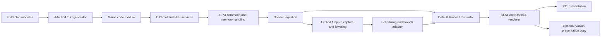

# NS2 integration and testing notes

Updated 2026-11-05. Branch: `beta_nx2`. Runtime marker: `v197-ns2-frontend`.

Follow-up source work is tracked in [Native GPU backend progress](NATIVE_GPU_BACKEND_PROGRESS.md). It adds ownership/queue backends without changing the deployed testing binary or completing guest IPC integration. The evidence table below records the initial synced testing baseline.

## Status and evidence

The runtime is ready for controlled Switch 1 regression tests and NS2 startup
diagnostics. Full NS2 support is **not implemented**. No first rendered Bananza
frame, gameplay result, audible NS2 output, or native QMD3 dispatch has been
verified in this session.

The work combines the historical NS2 imports with the newer C runtime rather
than replacing the runtime with the imported Eden implementation. The branch
merge records both histories. Shared runtime conflicts retained the newer
`beta_nx2` implementations, and the source branch's clock-context helper was
ported separately. The standalone imported Ampere frontend is now compiled;
most imported kernel, service, and graphics classes remain reference code.

| Evidence | Observed result | What this establishes |
| --- | --- | --- |
| Native regression runner | 14 groups passed | Covered C runtime behavior, including the repaired service assertions |
| NS2 frontend runner | Passed with address/undefined sanitizers | Bounded capture, reviewed instruction lowering, stream repacking, relocation, and rejection paths |
| Generated shaders | Vertex, fragment, and compute fixtures passed `glslangValidator` | Syntax/validation for those fixtures, not retail shader or driver parity |
| Recompiler checks | Eden A64 generation and remote-memory bypass checks passed | Covered generated templates and opt-in stub selection |
| X11 runtime build | Passed; tracked runtime binary rebuilt | Compilation and linkage of the current source and Ampere bridge |
| Game qualification | Not performed for this revision | User testing is still needed; earlier logs are historical evidence |

Host checks used x86-64 Linux, GCC 16.2.1, Python 3.14.9, and glslang 16.6.0.
These are the tested versions, not declared minimum requirements. The checks
do not establish Windows, ARM-host, or PS5 compatibility.

## Sources and transfer boundaries

The user supplied twelve reference documents from a different native/HLE
implementation. Their concrete failure contracts are useful; their Metal,
Apple scheduler, SDK-hooking, and packaging implementations do not transfer
directly to this Linux static recompiler. A diagnosis in those notes is evidence
about its recorded title/build, not proof of the same cause here.

The [source manifest](REFERENCE_SOURCE_MANIFEST.json) records the filenames,
original locations, SHA-256 digests, sizes, and line counts of the supplied
documents, plus the upstream documents consulted. The original local reference
files are not copied into this repository; the manifest identifies the actual
inputs used. The following sections synthesize their relevance rather than
reproducing their text.

| Supplied reference | Relevant contracts | Application to this runtime |
| --- | --- | --- |
| `audio.md` | Renderer ownership, kernel events, SDK-dependent command layouts, output queues, catch-up | Keep samples consumed, renderer update counters, output release, and event notification consistent; retain the existing 5 ms C audio path. NS2 `aud:u` now returns the maintained managers; Sysmix remains unimplemented. |
| `frame-rate.md` | Simulation time versus presentation intervals, timestamp units, submission completion, staging reuse | Record CPU/GPU timing domains independently. A frame cap must not imply altered guest simulation speed or prematurely reusable GPU memory. Native timestamp/profile parity still needs an audit. |
| `game-state.md` | Prerecorded commands, input conventions, script failures during teardown | Distinguish a menu/input wait or replayed command buffer from a scheduler stall. Investigate the first script/SDK error rather than assigning the teardown stack as the cause. |
| `memory.md` | Separate alias/stack/heap regions, memory budgets, mapping failures, real query results | Preserve guest VA/host pointer/GPU VA boundaries. Audit NS2 physical ownership, mapped ranges and process budgets; a larger virtual reservation is not proof of physical backing. |
| `movies.md` | Decoder lifecycle, held output slots, EOS/flush, native-texture output, VP9 | Test movie progress separately from rendering and audio. Preserve existing OpenH264/libvpx ownership; Apple decoder wrappers are not a Linux implementation. No new movie integration is claimed. |
| `nvn-objects.md` | SDK object sizes, sparse pool mappings, queue-local bindings, fence and residency lifetime | Do not embed oversized host records in guest objects. Resources remain owned until their consumers complete; address reuse must not revive stale bindings. Native NVMap/GSV/VI2 ownership remains a gap. |
| `packing.md` | External-drive behavior, RomFS deployment, compressed input, update/base selection | Test the actual installed game/module/data paths. Avoid mistaking a stale module or incomplete update extraction for a runtime fault. NS2 container/extraction parity is not established. |
| `rendering.md` | Resource transitions, staging lifetime, texture copies, format namespaces, attachment and storage-buffer bounds | Separate render-target formats from sampler formats, preserve copy sources until execution, and validate actual image extents. Existing GL rendering and Vulkan presentation remain distinct from native Vulkan game rendering. |
| `rewriter.md` | Indirect dispatch, exclusive windows, unwind/disassembly boundaries, packed relocations | Keep static/interpreter decoding consistent, regenerate modules when templates change, and audit loader relocation support from source. A method name in a guest stack does not prove which host stub ran. |
| `services.md` | Exact IPC output sizes, SDK overloads and return types, accounts, language codes, clocks, module resolution | Repair real dispatch contracts rather than returning blanket success. Account lookup and bounded replies are fixed; system-clock contexts now share the offset/steady-time/source-ID serializer. |
| `shaders.md` | Container provenance, compiler/cache identities, control flow, numeric semantics, resource metadata | Distinguish captured guest instructions from backend SPIR-V. Native Ampere goes through reviewed lowering; keep ISA cache identities separate and reject unsupported translations. Metal-specific compiler switches are not copied. |
| `threads.md` | Scheduler publication, core masks, event lifetime, exclusive ordering, SDK 22 TLS | Kernel thread IDs are now published at TLS `+0x110` before the thread becomes discoverable. The SDK's `+0x1f8` thread-object slot is preserved. Other scheduler claims require local tests. |

### Upstream NS2 documentation

The [Encore documentation index][upstream-index] provides NS2-specific contracts
missing from the general references. Its [unified roadmap][roadmap] separates
source integration, host tests, and real guest-frame evidence. Its hardware
qualification rules belong to that project; they are not an approval policy
for this Linux repository.

The [bootstrap notes][bootstrap] describe additive audio managers and process
ownership. The [GSV review][gsv] describes native allocation/binding/retirement
and rollback. The [QMD3 atomic-span review][atomic-span] requires actual bound
buffer sizes and rejects dynamic atomic offsets that lack executable bounds.
These are requirements for future integration, not features inherited merely
by importing files.

The [November 4 source reconciliation][reconciliation] retires the prototype
graphics-scaling application-proxy sources because their scale replies were
fabricated. Historical copies remain under the import for provenance and are
not compiled or promoted into this runtime. Source changes must be checked
against the current owner rather than assuming every imported file is current.

## Runtime architecture



This diagram shows implemented component boundaries. It does not assert that
native NS2 GPU command submission reaches the shader or presentation stages.
The C services and GPU frontend do not instantiate Eden's `Core::System`,
`KProcess`, `KSession`, Vulkan renderer, or C++ service framework.

### Build and deployment units

- [a64.py](../a64.py) and [codegen.py](../codegen.py) produce game-module C.
  Decoder or generated-hook changes require regeneration and rebuilding of the
  game code module; copying a runtime cannot update an existing module.
- [cpu.h](../runtime/cpu.h) is shared by the runtime and generated translation
  units. New inline dispatch tracing appears in old modules only after rebuild.
- [runtime source](../runtime/) produces the executable runtime. Shader, service,
  TLS and kernel changes require rebuilding and deploying that executable.
- [runtime_linux_x11](../bin/runtime_linux_x11) is the rebuilt tracked runtime.
  Existing game executable copies, game code modules, saves, and settings were
  not replaced by the integration work. Keep the running test executable stable
  while the branch is synced.

Graphical builds compile [ns2_shader.cpp](../runtime/ns2_shader.cpp) and the
imported `probe.cpp`/`lower_bridge.cpp` as temporary C++20 objects, then link
them with the C runtime and C++ standard library. The private compatibility
header supplies integer aliases only; it is not an Eden kernel compatibility
layer. The headless build path does not compile the Ampere frontend.

```bash
python3 switchrecomp.py --build-runtime --target linux --backend x11 --cc gcc
```

### Native shader capture and translation

[ns2_shader.h](../runtime/ns2_shader.h) defines a C ABI with an owned output
image, consumed source length, error byte offset, and diagnostic message.
The caller frees the image with `free`. C++ exceptions are converted to errors
before crossing the C boundary.

1. The shader ISA is explicitly selected with `SWR_SHADER_ISA=ampere` at process
   start. Maxwell remains the default. This selector does not implement native
   engine classes, QMD3 launch descriptors, or a process capability profile.
2. Native graphics has a `0x80`-byte header. Native compute is headerless. The
   capture reader checks mapped GPU pages and reads individual 16-byte native
   instructions, with a limit of 4096 instructions and overflow checks.
3. Capture follows the supported control-flow termination contract, including
   forward destinations beyond an earlier EXIT. Missing terminators, invalid
   targets and unmapped reads fail.
4. The imported probe validates opcode/field masks, then the lowering frontend
   emits supported Maxwell instructions. Unknown or unreviewed semantics fail.
   Native indirect branches are rejected because the C consumer does not yet
   support the required native-PC table mapping.
5. The adapter repacks scheduling words: the imported layout's first instruction
   starts at `0x50`, while the C translator starts at `0x58` and skips scheduling
   slots relative to `0x50`. Direct branch/call/convergence targets are relocated
   to the new addresses. Lowered programs beyond the C translator's supported
   scan limit are rejected.
6. [gpu_gl.c](../runtime/gpu_gl.c) passes the resulting image to the existing
   GLSL translator in both graphics and compute ingestion. Native cache keys
   are separated from Maxwell keys. Downstream unsupported instructions prevent
   native shader execution; a syntactically generated placeholder is not success.

The C translator also includes the existing HSETP2 register/immediate helpers
and CAL/RET work. Those narrow helpers alone are not an Ampere stream decoder.
Native compute shader ingestion still operates within the existing command
path; it does not make QMD3 command execution available.

### Service, audio, and thread fixes

[svc_core.c](../runtime/svc_core.c) now covers the failing service contracts:

- Account existence compares a complete 16-byte user ID and rejects absent,
  short, or different input. Command 141 fills the selected output descriptor
  within its stated size, including zeroing unused list storage.
- Settings choose a valid fallback for an invalid language index; language-list
  counts are bounded before narrowing, and device-name copies respect short
  caller buffers.
- Renderer creation/work-size queries check parameter length and bounded
  mixer/resource counts. Total mix-buffer capacity is distinct from per-bus
  channel count. CPU-time-limit state is stored separately from the frame
  counter used by RequestUpdate.
- NS2 `aud:u` commands 1 and 2 return independent real output/renderer manager
  objects backed by the existing dispatch functions. Malformed or unsupported
  requests return errors. This is not Sysmix, StreamPlay, or confirmed NS2 sound.
- System-clock context replies contain offset, steady time, and source ID,
  using the same wire layout as the clock-snapshot context.

[kernel.c](../runtime/kernel.c) initializes TLS `+0x110` with the nonzero kernel
thread ID before publishing the thread in the runtime list. Main and worker
threads share this creation path. It does not fabricate the SDK-owned pointer
at `+0x1f8`. The regression test checks distinct IDs and unchanged surrounding
TLS bytes.

### CPU additions, generated bypasses, and dispatch tracing

The synced source also includes the previously local AArch64 additions: CASP,
selected pointer-authentication encodings, authenticated loads, and memory-tag
instruction handling. Static and interpreter paths share templates. These are
selected compatibility implementations, not complete ARMv8.5/PAC/MTE emulation.
The non-x86 fallback for paired 128-bit CAS does not guarantee pair atomicity;
the successful host checks do not qualify that fallback.

The five `--skip-switch2-*` generator switches remain opt-in diagnostics. They
bypass remote-memory boot, syncpoint initialization, native-memory setup,
frame-management setup, or the donated-transfer query for specific SDK symbols.
They do not implement those subsystems or prove correct output-pointer
contracts. Record every enabled bypass in a test report; do not silently make
them the definition of NS2 support.

`SWR_TRACE_GUEST_PC` selects a guest address for bounded lookup diagnostics.
The log includes the guest PC/LR and chosen host target/interpreter state.
Rebuild generated modules to include the changed inline lookup. A guest memory
instruction dump or nearest symbol is not proof that a generated stub executed.

## Remaining NS2 integration work

| Area | Required implementation and acceptance evidence |
| --- | --- |
| Process/profile selection | Derive native capabilities and clock/address-space choices from validated metadata. Do not infer the entire execution profile from a filename or shader word. Restore NS1 state on title transitions. |
| GSV and GPU workers | Exact IPC/TIPC envelopes, owned session/process/event objects, worker leases, real request results, and teardown. Unsupported operations must remain explicit. |
| Native memory | NVMap/GMMU backing ownership, mapped-range/attribute checks, parent pins and duplicates, rollback on partial failure, and deferred retirement until consumers release resources. A metadata ID is not physical backing. |
| QMD3 | Decode native descriptors, authenticate process/channel/epoch, validate constant/storage/image bindings and offsets, execute actual work, and publish completion only after execution and output visibility. |
| Atomics/resources | Bound static atomic spans against actual resource sizes; reject dynamic offsets until runtime bounds are executable. Do not redirect invalid accesses to buffer element zero. |
| Native graphics | Native engine and macro handling, complete stage/resource contracts, supported shader semantics, and compatible textures/attachments. Task/mesh/geometry support must be established individually. |
| VI2/presentation | Retained image registrations, acquisition and release ownership, vblank and fence behavior, and a verified guest framebuffer reaching presentation. A host loading screen is not a guest frame. |
| Sysmix/StreamPlay | Real process-owned streams/shared memory, queue admission, PCM conversion, backpressure and event lifetime. Returning a manager is not implementing its stream protocol. |
| Content and loader | Validate actual NPDM, container/update selection, relocations, and module loading for each tested build. The references do not establish these features in this loader. |

Implement these against current upstream owners and local behavioral tests.
The imported prototype files and synthetic test success are not substitutes
for those owners. Upstream's host successes and PS5 restrictions also do not
constitute Linux game qualification.

## Test and reporting procedure

Run commands from the repository root:

```bash
python3 scripts/test_runtime_ports.py
python3 scripts/test_ns2_shader.py
python3 scripts/test_eden_a64.py
```

The full runtime runner already invokes the NS2 frontend runner; its standalone
command is useful when isolating a shader regression. It uses the C compiler's
C++20 frontend and C++ standard library; install `glslangValidator` to include
the external shader validation step. Without that executable, the frontend
runner still tests translation but skips external GLSL validation.

The 14 native groups cover shader dimensions, HSETP2, CAL/RET, clocks, LSE
atomics, service ports, IPC sessions, TLS IDs, DSP effects, audio routing,
renderer updates, fonts, heaps, and filesystem behavior. The codegen bypass
tests are plain Python test functions and may be run with pytest when available.

For manual tests:

1. Identify the executable runtime version from its log and record the game
   build, code-module rebuild state, GPU/driver, backend, and all overrides.
   A rebuilt binary in the repository does not update existing game copies.
2. Preserve the prior executable and logs before installing a runtime into a
   game's launcher path. Use separate test saves/settings/caches where possible.
   Do not replace an executable while its test is running.
3. Start NS1 regressions with Maxwell/default settings. Check startup, visible
   output, audio progression, input, movie transitions and shutdown separately.
4. For a deliberate native-shader experiment, select Ampere before launch:

   ```bash
   SWR_SHADER_ISA=ampere ./games/base
   ```

   Use this only for a known native shader test; it is not a universal switch
   for NS2 support, and it changes decoding for the process. Native boot may
   stop before shader ingestion because the other subsystems are incomplete.
5. Save the first meaningful error and its preceding log context. Record draw,
   submission and presentation counters if available. A screenshot alone
   cannot distinguish a loading UI, stale image and guest-rendered frame.
6. Retest the same build/settings after a change. Attribute compatibility or
   performance improvements only to measured evidence.

Suggested report:

```text
Branch/commit and runtime marker:
Game/version/build ID:
Code module rebuilt with this revision? Dated module path:
GPU/driver and presentation backend:
ISA selection and generator bypass flags:
Separate saves/settings/cache paths:
First startup error (or time to first visible guest frame):
Draw/submission/presentation counters:
Audio/input/movie behavior:
Exit reason and log path:
```

## Related project documents

- [Session handoff](../SESSION_HANDOFF.md): current implementation and checks.
- [Technical progress](../TECHNICAL_PROGRESS.md): historical Bananza startup,
  CPU and shader investigation, with its original evidence limits.
- [Imported source status](../vendor/nx2_imports/README.md): compiled subset and
  upstream follow-up references.
- [Linux usage](../README_LINUX.txt): runtime build and test selection.
- [Notices](../NOTICE.txt) and [GPL license](../LICENSES/GPL-3.0.txt): imported
  frontend attribution; individual upstream SPDX notices remain in the source.

[upstream-index]: https://git.eden-emu.dev/niakw/ProsperoEden-Encore/src/branch/main/docs
[roadmap]: https://git.eden-emu.dev/niakw/ProsperoEden-Encore/src/branch/main/docs/ROADMAP_NS1_NS2_UNIFIED.md
[bootstrap]: https://git.eden-emu.dev/niakw/ProsperoEden-Encore/src/branch/main/docs/NS2_HLE_BOOTSTRAP_2026-11-01.md
[gsv]: https://git.eden-emu.dev/niakw/ProsperoEden-Encore/src/branch/main/docs/NS2_GSV_NATIVE_MEMORY_REVIEW_2026-11-01.md
[atomic-span]: https://git.eden-emu.dev/niakw/ProsperoEden-Encore/src/branch/main/docs/NS2_ATOMIC_SPAN_QMD3_2026-11-05.md
[reconciliation]: https://git.eden-emu.dev/niakw/ProsperoEden-Encore/src/branch/main/docs/NS1_NS2_HOST_SOURCE_RECONCILIATION_2026-11-04.md
